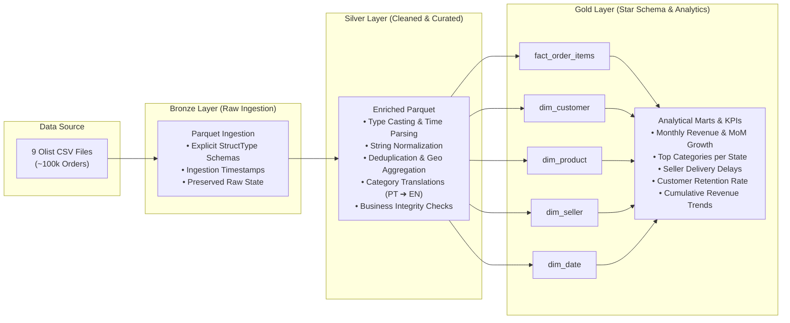
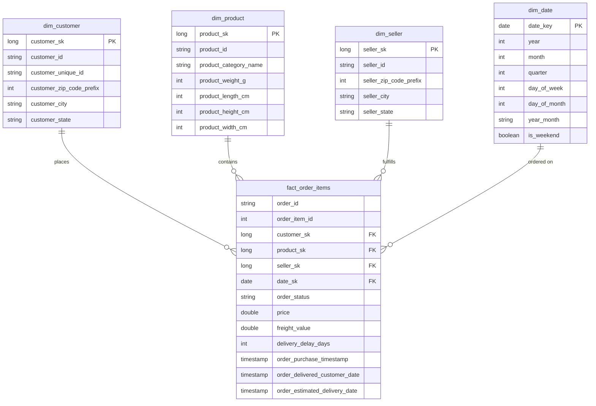

# 🛒 Olist E-Commerce Medallion Data Engineering Pipeline

[](https://spark.apache.org/)
[](https://www.python.org/)
[](https://github.com/astral-sh/uv)
[-00A86B.svg)]()

An end-to-end data engineering pipeline and lakehouse implementation built with **PySpark**, processing ~100k Brazilian e-commerce orders from the [Olist Dataset](https://www.kaggle.com/datasets/olistbr/brazilian-ecommerce). The project implements a **Medallion Architecture** (Bronze ➔ Silver ➔ Gold), cleans relational inconsistencies, models an analytical **Star Schema** (Fact & Dimensions), and extracts core business metrics (KPIs) and visualizations.

---

## 📌 Architecture Overview

The pipeline organizes data into three distinct quality and refinement zones:



---

## 🏗️ Medallion Layers

| Layer | Path | Description & Transformations |
| :--- | :--- | :--- |
| **Bronze** | [`data/bronze/`](file:///c:/Users/yahya/Desktop/DE/data/bronze) | **Raw Ingestion**: Reads source CSV files using strict `StructType` schemas (avoiding expensive and error-prone `inferSchema`). Appends `ingestion_timestamp` and writes unmodified data into partitioned Parquet format. |
| **Silver** | [`data/silver/`](file:///c:/Users/yahya/Desktop/DE/data/silver) | **Cleaned & Standardized**: Dates converted from strings to timestamps; string columns trimmed and lowercased; duplicates removed (crucial for geolocation zip codes); Portuguese category names joined with translations; invalid/null values audited. |
| **Gold** | [`data/gold/`](file:///c:/Users/yahya/Desktop/DE/data/gold) | **Dimensional Modeling (Star Schema)**: Fact and dimension tables equipped with surrogate keys (`*_sk`), optimized for analytical OLAP queries, plus pre-computed analytical KPI datasets. |

---

## 🌟 Star Schema (Gold Layer)

The gold layer models the e-commerce domain as a Kimball-style dimensional star schema:



### 🔑 Key Data Engineering Design Decisions

1. **Fact Table Grain**:
   - The grain of [`fact_order_items`](file:///c:/Users/yahya/Desktop/DE/gold.ipynb) is **one row per item sold** (`order_id` + `order_item_id`). An order may contain multiple items, potentially from different sellers with different shipping limits and prices. Modeling at the item grain avoids loss of seller- and product-level granularity.
2. **`customer_id` vs. `customer_unique_id`**:
   - In Olist, `customer_id` is an order-scoped token (changes with every purchase).
   - `customer_unique_id` identifies the actual human entity across multiple orders. Retaining both in `dim_customer` allows accurate identification of repeat customers.
3. **Delivery Delay Calculation**:
   - Derived metric: `delivery_delay_days = datediff(order_delivered_customer_date, order_estimated_delivery_date)`.
   - Positive values indicate late deliveries; negative values indicate deliveries that arrived earlier than estimated.
4. **Pre-aggregating Payments**:
   - When calculating revenue from payments, payments are grouped by `order_id` before joining with `orders` to prevent fan-out / Cartesian inflation caused by multi-item or split-installment orders.

---

## 📊 Business Intelligence & KPIs

Computed from the Gold layer tables inside [`gold.ipynb`](file:///c:/Users/yahya/Desktop/DE/gold.ipynb):

| # | Business KPI | Spark Engine Implementation | Output Dataset |
| :---: | :--- | :--- | :--- |
| **1** | **Monthly Revenue & MoM Growth** | `lag("revenue")` window partitioned chronologically to compute percentage change over time. | `kpi_monthly_revenue.parquet` |
| **2** | **Top 3 Product Categories per State** | `row_number()` window partitioned by `customer_state` and ordered by `total_revenue DESC`. | `kpi_top3_categories_per_state.parquet` |
| **3** | **Average Delivery Delay per Seller** | Aggregates actual vs. estimated delivery variance, average delay days, and seller delay rate (`late_pct`). | `kpi_delivery_delay_per_seller.parquet` |
| **4** | **Repeat-Customer Rate** | Grouping by `customer_unique_id` to evaluate retention rate (one-time vs. repeat buyers). | `kpi_repeat_customer_rate.parquet` |
| **5** | **Cumulative Revenue Over Time** | Running total with `sum().over(Window.rowsBetween(unboundedPreceding, currentRow))`. | `kpi_cumulative_revenue.parquet` |
| **6** | **Payment Method Breakdown** | Revenue share %, average transaction size, and installment behavior across credit card, boleto, voucher, and debit. | `kpi_revenue_by_payment_type.parquet` |

### 📈 Revenue Visualization

The project includes an automated visualization pipeline in [`analysis.py`](file:///c:/Users/yahya/Desktop/DE/analysis.py):


---

## 📁 Repository Structure

```text
├── .hadoop/                  # Automatic local Hadoop winutils binaries for Windows
├── data/
│   ├── raw/                  # Downloaded raw Olist CSV files
│   ├── bronze/               # Ingested Parquet files with explicit schema
│   ├── silver/               # Cleaned, typed, and deduplicated Parquet files
│   └── gold/                 # Star schema (fact/dims) and analytical Parquet outputs
├── analysis.py               # Visual analytics script generating matplotlib charts
├── data_design_tables.md     # Detailed data dictionary, ER diagrams, and join paths
├── download_olist.py         # Automated Kaggle dataset downloader script
├── ingestion.ipynb           # Phase 1: Raw ingestion to Bronze layer
├── silver.ipynb              # Phase 2: Cleaning and Silver transformations
├── gold.ipynb                # Phase 3: Star schema modeling and KPI generation
├── plan.md                   # Project architecture blueprint and definition of done
├── pysparkcode.py            # PySpark syntax reference and performance tuning guide
├── pyproject.toml            # Project dependencies and packaging metadata
├── spark_windows.py          # Windows Hadoop / winutils automatic configuration helper
└── uv.lock                   # Deterministic lockfile
```

---

## 🚀 Getting Started

### 1. Prerequisites

- **Python**: 3.11+ (Python 3.14 tested)
- **Java**: JDK 17+ installed and set on `JAVA_HOME`
- **uv**: Recommended package manager ([astral.sh/uv](https://astral.sh/uv))

### 2. Environment Setup

Clone the repository and install dependencies with `uv`:

```bash
# Clone the repository
git clone https://github.com/YahyaGhallali/Medallion-ecommerce.git
cd Medallion-ecommerce

# Install dependencies into virtual environment
uv sync
```

### 3. Windows Hadoop Setup

If running on Windows, PySpark requires Hadoop native binaries (`winutils.exe` and `hadoop.dll`). This repository handles this automatically via [`spark_windows.py`](file:///c:/Users/yahya/Desktop/DE/spark_windows.py):

```python
from spark_windows import configure_windows_hadoop

# Automatically downloads winutils.exe and hadoop.dll to .hadoop/bin and configures HADOOP_HOME
configure_windows_hadoop()
```

### 4. Fetch the Dataset

To fetch the raw dataset directly from Kaggle:

```bash
# Configure your Kaggle credentials (~/.kaggle/kaggle.json or env vars)
# Run the download script
uv run python download_olist.py --output-dir data/raw
```

### 5. Running the Pipeline

Execute the pipeline layers sequentially:

1. **Bronze Layer**: Open and execute [`ingestion.ipynb`](file:///c:/Users/yahya/Desktop/DE/ingestion.ipynb) to ingest raw CSVs to Parquet with explicit schemas.
2. **Silver Layer**: Run [`silver.ipynb`](file:///c:/Users/yahya/Desktop/DE/silver.ipynb) to clean, standardize, and deduplicate tables.
3. **Gold Layer**: Run [`gold.ipynb`](file:///c:/Users/yahya/Desktop/DE/gold.ipynb) to generate the dimensional star schema and compute business KPIs.
4. **Visual Analytics**: Generate revenue and MoM growth charts:
   ```bash
   uv run python analysis.py
   ```

---

## 🛠️ Performance & Engineering Best Practices

- **Explicit Schemas**: Ingestion disables `inferSchema` across all 9 tables, preventing costly full-file scans and type ambiguities.
- **Controlled Partitions**: Set `spark.sql.shuffle.partitions` to `8` for local multi-core execution instead of Spark's default `200`, eliminating excessive task scheduling overhead on laptop hardware.
- **Broadcast Joins**: Used on smaller lookup dimensions (`dim_seller`, `dim_product`, category translations) to eliminate expensive cross-network shuffles during joins.
- **Windowing over Self-Joins**: MoM growth and category ranking utilize native Spark SQL window functions (`lag`, `row_number`) rather than expensive recursive joins.

---

## 📜 License

This project is licensed under the MIT License - see the repository for details.
Dataset provided by [Olist](https://www.kaggle.com/datasets/olistbr/brazilian-ecommerce) via Kaggle.
