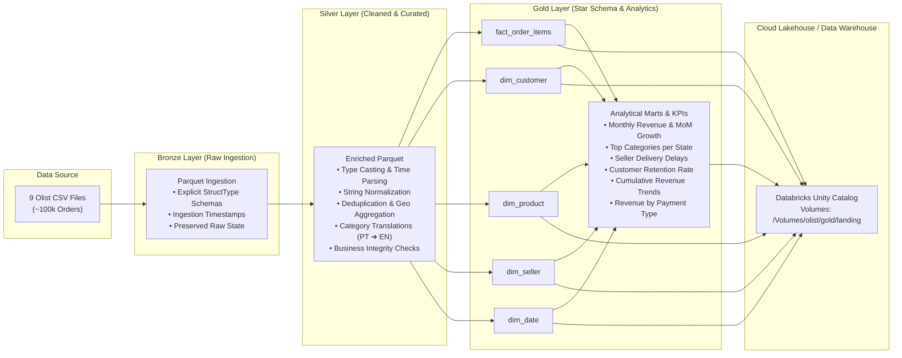
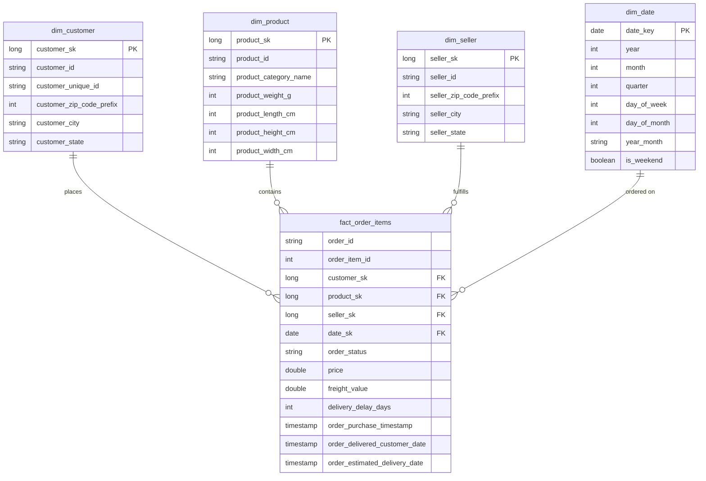

# 🛒 Olist E-Commerce Medallion Data Engineering Pipeline

[](https://spark.apache.org/)
[](https://www.python.org/)
[](https://databricks.com/)
[](https://github.com/astral-sh/uv)
[-00A86B.svg)]()

An end-to-end data engineering pipeline and lakehouse implementation built with **PySpark** and **Databricks**, processing ~100k Brazilian e-commerce orders from the [Olist Dataset](https://www.kaggle.com/datasets/olistbr/brazilian-ecommerce). The project implements a **Medallion Architecture** (Bronze ➔ Silver ➔ Gold), cleans relational inconsistencies, models an analytical **Star Schema** (Fact & Dimensions), extracts core business metrics (KPIs), and publishes curated data to **Databricks Unity Catalog Volumes**.

---

## 📌 Architecture Overview

The pipeline organizes data into three distinct quality and refinement zones and exports curated datasets to the cloud:



---

## 🏗️ Medallion Layers & Modules

The pipeline is implemented as a modular Python package under [`workflow/`](file:///c:/Users/yahya/Desktop/DE/workflow):

| Layer | Script / Module | Path | Description & Transformations |
| :--- | :--- | :--- | :--- |
| **Bronze** | [`workflow/bronze.py`](file:///c:/Users/yahya/Desktop/DE/workflow/bronze.py) | [`data/bronze/`](file:///c:/Users/yahya/Desktop/DE/data/bronze) | **Raw Ingestion**: Reads source CSV files using strict `StructType` schemas (avoiding expensive and error-prone `inferSchema`). Appends `ingestion_timestamp` and writes unmodified data into Parquet format. |
| **Silver** | [`workflow/silver.py`](file:///c:/Users/yahya/Desktop/DE/workflow/silver.py) | [`data/silver/`](file:///c:/Users/yahya/Desktop/DE/data/silver) | **Cleaned & Standardized**: Dates converted from strings to timestamps; string columns trimmed and lowercased; duplicates removed (crucial for geolocation zip codes); Portuguese category names joined with translations; invalid/null values filtered. |
| **Gold** | [`workflow/gold.py`](file:///c:/Users/yahya/Desktop/DE/workflow/gold.py) | [`data/gold/`](file:///c:/Users/yahya/Desktop/DE/data/gold) | **Dimensional Modeling (Star Schema)**: Fact and dimension tables equipped with surrogate keys (`*_sk`), optimized for analytical OLAP queries, plus pre-computed analytical KPI datasets. |
| **Publish** | [`workflow/publish_databricks.py`](file:///c:/Users/yahya/Desktop/DE/workflow/publish_databricks.py) | `/Volumes/olist/gold/landing` | **Cloud Export**: Uses `databricks-sdk` to upload all Gold layer tables and KPI Parquet files directly into Databricks Unity Catalog Volumes. |

---

## 🌟 Star Schema (Gold Layer)

The gold layer models the e-commerce domain as a Kimball-style dimensional star schema:



### 🔑 Key Data Engineering Design Decisions

1. **Fact Table Grain**:
   - The grain of [`fact_order_items`](file:///c:/Users/yahya/Desktop/DE/workflow/gold.py) is **one row per item sold** (`order_id` + `order_item_id`). An order may contain multiple items, potentially from different sellers with different shipping limits and prices. Modeling at the item grain avoids loss of seller- and product-level granularity.
2. **`customer_id` vs. `customer_unique_id`**:
   - In Olist, `customer_id` is an order-scoped token (changes with every purchase).
   - `customer_unique_id` identifies the actual human entity across multiple orders. Retaining both in `dim_customer` allows accurate identification of repeat customers.
3. **Delivery Delay Calculation**:
   - Derived metric: `delivery_delay_days = datediff(order_delivered_customer_date, order_estimated_delivery_date)`.
   - Positive values indicate late deliveries; negative values indicate deliveries that arrived earlier than estimated.
4. **Pre-aggregating Payments**:
   - When calculating revenue from payments, payments are grouped by `order_id` before joining with `orders` to prevent fan-out / Cartesian inflation caused by multi-item or split-installment orders.

---

## 📊 Business Intelligence & KPIs

Computed from the Gold layer tables inside [`workflow/gold.py`](file:///c:/Users/yahya/Desktop/DE/workflow/gold.py) (and interactive [`gold.ipynb`](file:///c:/Users/yahya/Desktop/DE/gold.ipynb)):

| # | Business KPI | Spark Engine Implementation | Output Dataset |
| :---: | :--- | :--- | :--- |
| **1** | **Monthly Revenue & MoM Growth** | `lag("revenue")` window partitioned chronologically to compute percentage change over time. | `kpi_monthly_revenue.parquet` |
| **2** | **Top 3 Product Categories per State** | `row_number()` window partitioned by `customer_state` and ordered by `total_revenue DESC`. | `kpi_top3_categories_per_state.parquet` |
| **3** | **Average Delivery Delay per Seller** | Aggregates actual vs. estimated delivery variance, average delay days, and seller delay rate (`late_pct`). | `kpi_delivery_delay_per_seller.parquet` |
| **4** | **Repeat-Customer Rate** | Grouping by `customer_unique_id` to evaluate retention rate (one-time vs. repeat buyers). | `kpi_repeat_customer_rate.parquet`<br>`kpi_order_count_distribution.parquet` |
| **5** | **Cumulative Revenue Over Time** | Running total with `sum().over(Window.rowsBetween(unboundedPreceding, currentRow))`. | `kpi_cumulative_revenue.parquet` |
| **6** | **Payment Method Breakdown** | Revenue share %, transaction count, and average installments across credit card, boleto, voucher, and debit. | `kpi_revenue_by_payment_type.parquet` |

---

## 📁 Repository Structure

```text
├── .hadoop/                        # Automatic local Hadoop winutils binaries for Windows
├── data/                           # Medallion data directories (gitignored)
│   ├── raw/                        # Downloaded raw Olist CSV files
│   ├── bronze/                     # Ingested Parquet files with explicit schema
│   ├── silver/                     # Cleaned, typed, and deduplicated Parquet files
│   └── gold/                       # Star schema (fact/dims) and analytical Parquet outputs
├── experimental-notebooks/         # Exploratory prototyping Jupyter notebooks
│   ├── ingestion.ipynb             # Phase 1 exploratory raw ingestion
│   ├── silver.ipynb                # Phase 2 exploratory cleaning & transformations
│   └── gold.ipynb                  # Phase 3 exploratory modeling & KPI testing
├── info-docs/                      # Architecture blueprints & reference documents
│   ├── data_design_tables.md       # Comprehensive data dictionary, ER diagrams & joins
│   └── plan.md                     # Medallion architecture roadmap & definition of done
├── workflow/                       # Modular production pipeline package
│   ├── __init__.py                 # Package marker
│   ├── common.py                   # Shared paths and SparkSession factory
│   ├── bronze.py                   # Bronze layer raw ingestion
│   ├── silver.py                   # Silver layer data cleansing & curation
│   ├── gold.py                     # Gold layer dimensional modeling & KPIs
│   ├── run_pipeline.py             # CLI runner for end-to-end pipeline execution
│   └── publish_databricks.py       # Databricks Unity Catalog Volume publisher
├── download_olist.py               # Automated Kaggle dataset downloader script
├── gold.ipynb                      # Root interactive notebook for gold layer analysis
├── pysparkcode.py                  # PySpark syntax reference and performance tuning guide
├── pyproject.toml                  # Project dependencies and packaging metadata
├── spark_windows.py                # Windows Hadoop / winutils & Python worker configuration
└── uv.lock                         # Deterministic lockfile
```

---

## 🚀 Getting Started

### 1. Prerequisites

- **Python**: 3.11+ (Python 3.14 tested)
- **Java**: JDK 17+ installed and configured on `JAVA_HOME`
- **uv**: Recommended high-speed package manager ([astral.sh/uv](https://astral.sh/uv))

### 2. Environment Setup

Clone the repository and install dependencies using `uv`:

```bash
# Clone the repository
git clone https://github.com/YahyaGhallali/Medallion-ecommerce.git
cd Medallion-ecommerce

# Install dependencies into virtual environment
uv sync
```

### 3. Windows Hadoop Configuration

When executing PySpark on Windows, Hadoop native binaries (`winutils.exe` and `hadoop.dll`) and worker Python environment paths are configured automatically via [`spark_windows.py`](file:///c:/Users/yahya/Desktop/DE/spark_windows.py):

```python
from spark_windows import configure_windows_hadoop

# Downloads winutils/hadoop.dll to .hadoop/bin and sets HADOOP_HOME & PYSPARK_PYTHON
configure_windows_hadoop()
```

### 4. Fetch the Dataset

Download the Olist Brazilian E-Commerce dataset directly from Kaggle:

```bash
# Ensure Kaggle credentials are configured (~/.kaggle/kaggle.json or KAGGLE_USERNAME / KAGGLE_KEY)
uv run python download_olist.py --output-dir data/raw
```

### 5. Running the Pipeline via CLI

The pipeline can be executed as a unified process or by individual stages using [`workflow/run_pipeline.py`](file:///c:/Users/yahya/Desktop/DE/workflow/run_pipeline.py):

```bash
# Run the entire pipeline end-to-end (Bronze -> Silver -> Gold)
uv run python workflow/run_pipeline.py --stage all

# Or run a specific stage independently:
uv run python workflow/run_pipeline.py --stage bronze
uv run python workflow/run_pipeline.py --stage silver
uv run python workflow/run_pipeline.py --stage gold
```

### 6. Publishing Gold Datasets to Databricks

Deploy all Gold layer Star Schema dimensions, fact tables, and computed KPIs to **Databricks Unity Catalog Volumes** using [`workflow/publish_databricks.py`](file:///c:/Users/yahya/Desktop/DE/workflow/publish_databricks.py):

1. Create a `.env` file in the root directory (or export environment variables):
   ```ini
   DATABRICKS_HOST="https://<databricks-instance>.cloud.databricks.com"
   DATABRICKS_TOKEN="dapi********************************"
   ```

2. Execute the publisher:
   ```bash
   uv run python workflow/publish_databricks.py
   ```
   This uploads all parquet partitions directly into the target volume path: `/Volumes/olist/gold/landing/<table_name>/<filename>.parquet`.

### 7. Interactive Exploration (Jupyter)

For exploratory analysis and visual checks:

```bash
# Launch Jupyter
uv run jupyter lab

# Explore notebooks:
# - experimental-notebooks/ingestion.ipynb
# - experimental-notebooks/silver.ipynb
# - experimental-notebooks/gold.ipynb (or root gold.ipynb)
```

---

## 🛠️ Performance & Engineering Best Practices

- **Explicit Schemas**: Ingestion disables `inferSchema` across all 9 tables, eliminating costly full-file scans and schema ambiguity.
- **Controlled Shuffle Partitions**: Configured `spark.sql.shuffle.partitions` to `8` for local multi-core execution instead of Spark's default `200`, preventing excessive task scheduling overhead on laptop hardware.
- **Broadcast Joins**: Applied to smaller lookup dimensions (`dim_seller`, `dim_product`, category translations) to eliminate expensive cross-network shuffles.
- **Window Functions over Self-Joins**: Month-over-month growth, category rankings, and cumulative totals leverage native Spark SQL window functions (`lag`, `row_number`, unbounded window frames).
- **Environment Consistency**: `spark_windows.py` dynamically anchors `PYSPARK_PYTHON` and `PYSPARK_DRIVER_PYTHON` to the active virtual environment's Python executable.

---

## 📜 License

This project is licensed under the MIT License - see the repository for details.
Dataset provided by [Olist](https://www.kaggle.com/datasets/olistbr/brazilian-ecommerce) via Kaggle.
