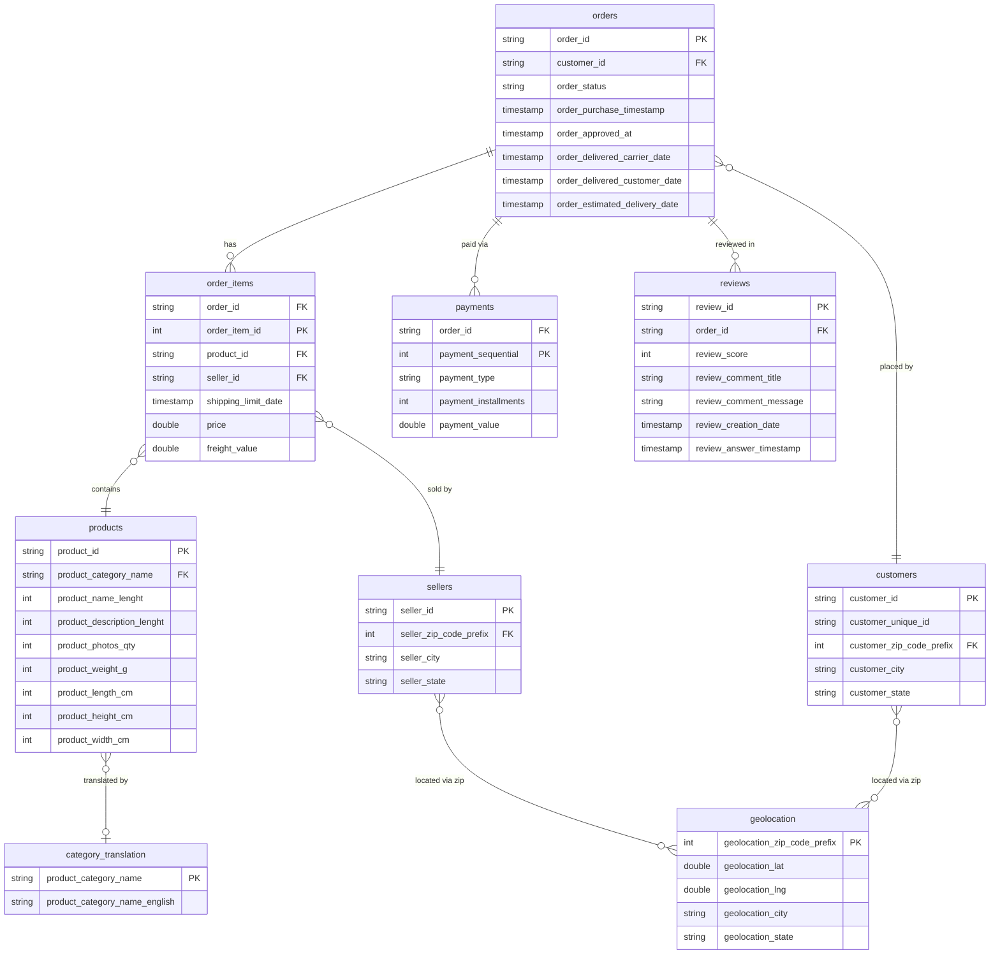
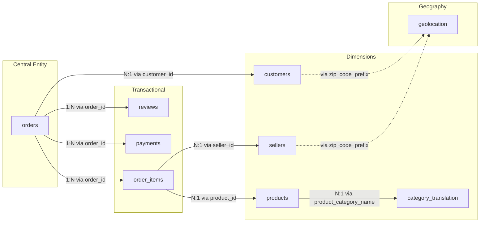

# Olist E-Commerce Database Overview

## Entity-Relationship Diagram

## Tables Summary

| Table | Rows (approx) | Primary Key | Description |
|-------|---------------|-------------|-------------|
| `orders` | 99,441 | `order_id` | One row per order — status and timestamps |
| `order_items` | 112,650 | `order_id` + `order_item_id` | One row per item in an order (an order can have multiple items) |
| `customers` | 99,441 | `customer_id` | One row per order-customer pair. `customer_unique_id` identifies the actual person across orders |
| `products` | 32,951 | `product_id` | Product catalog with dimensions and category |
| `sellers` | 3,095 | `seller_id` | Marketplace sellers with location |
| `payments` | 103,886 | `order_id` + `payment_sequential` | One row per payment method used on an order (an order can be split across methods) |
| `reviews` | 99,224 | `review_id` + `order_id` | Customer reviews with scores (1–5) and optional comments |
| `geolocation` | 1,000,163 | `zip_code_prefix` (non-unique) | Multiple lat/lng points per zip code — no true PK |
| `category_translation` | 71 | `product_category_name` | Portuguese → English category name lookup |

## Relationship Details

## Join Paths

| From | To | Join Key | Cardinality |
|------|----|----------|-------------|
| `orders` | `order_items` | `order_id` | 1 → N |
| `orders` | `payments` | `order_id` | 1 → N |
| `orders` | `reviews` | `order_id` | 1 → N |
| `orders` | `customers` | `customer_id` | N → 1 |
| `order_items` | `products` | `product_id` | N → 1 |
| `order_items` | `sellers` | `seller_id` | N → 1 |
| `products` | `category_translation` | `product_category_name` | N → 1 |
| `customers` | `geolocation` | `customer_zip_code_prefix = geolocation_zip_code_prefix` | N → N |
| `sellers` | `geolocation` | `seller_zip_code_prefix = geolocation_zip_code_prefix` | N → N |

## Key Gotchas

> [!WARNING]
> **`customer_id` ≠ person.** Each `customer_id` is unique to one order. The actual person is identified by `customer_unique_id`. You must use `customer_unique_id` when counting repeat customers.

> [!NOTE]
> **`geolocation` has no true primary key.** A single zip code maps to many lat/lng points (multiple neighborhoods). Joining directly will produce duplicates — aggregate or deduplicate first.

> [!NOTE]
> **`order_items` is the fact table grain.** A single order can have multiple items from different sellers at different prices. `order_id` + `order_item_id` is the composite key.
